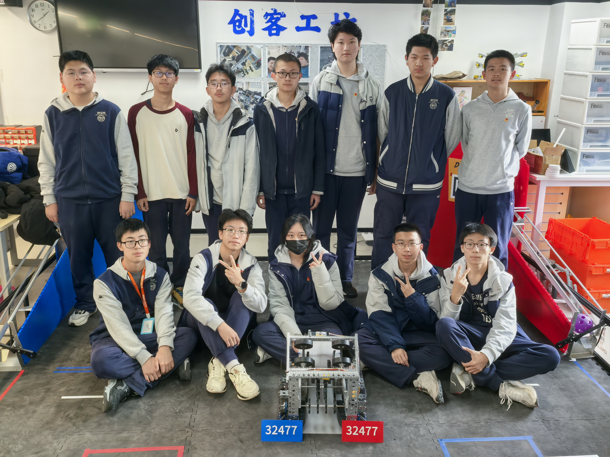

# 编译工具语法示例

本页用于人工验证编译器新增的图片与排版语法（HTML/PDF 双端）。构建方式见 `demo/build_demo.py`。

## 1. 单图与尺寸

{w=60%}

## 2. 图注编号与交叉引用

图号引用测试：见  与 。

{#fig:hub}

{#fig:power}

## 3. 图片组（两列并排）

## 4. 图文并排

::: side
### 文字在左
这里是一段与图片并排的说明文字。可以包含列表：

- 第一项：检查电源灯
- 第二项：检查 Driver Station 连接

{w=100%}
:::

::: side reverse 40
### 图片在左
文字在右，图片占 40% 宽度。用于展示 `reverse` 与自定义图片列宽。

:::

## 5. 三列网格

::: grid 3

:::

## 6. 整块保持

::: keep
> [!warning] 这段提示应尽量不跨页
> 如果内容较短，应与标题保持在同一页内。
:::

## 7. 强制分页（PDF）

::: break
:::

## 8. 分页之后

上方 `::: break` 在 PDF 中应强制换页；HTML 中不显示分页。
